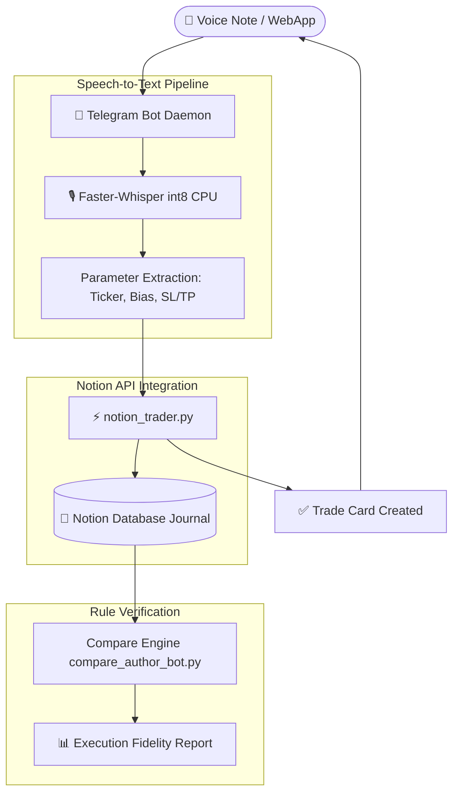

<div align="center">

# ⚡ Trading Journal & Notion Voice Assistant Bot

**Telegram Bot & WebApp for automated trade logging directly into Notion databases powered by Faster-Whisper on-device voice transcription, automated Risk-to-Reward (R:R) computation, and signal audit verification.**

[](https://www.python.org/)
[](https://core.telegram.org/bots)
[](https://developers.notion.com/)
[](https://github.com/SYSTRAN/faster-whisper)
[](LICENSE)

[🇷🇺 Читать на русском](README.md) • [🇬🇧 Read in English](README.en.md)

---

</div>

## 📑 Table of Contents

1. [Trader Problem & Architectural Solution](#1-trader-problem--architectural-solution)
   * [1.1. Journal Logging Friction](#11-journal-logging-friction)
   * [1.2. The Voice-Driven Assistant](#12-the-voice-driven-assistant)
2. [Key Capabilities](#2-key-capabilities)
   * [2.1. On-Device Voice Transcription (Faster-Whisper)](#21-on-device-voice-transcription-faster-whisper)
   * [2.2. Direct Notion Database Sync (notion_trader.py)](#22-direct-notion-database-sync-notion_traderpy)
   * [2.3. Telegram WebApp Interactive Order Ticket](#23-telegram-webapp-interactive-order-ticket)
   * [2.4. Signal Audit vs. Algorithmic Backtests](#24-signal-audit-vs-algorithmic-backtests)
3. [Architecture & Data Pipeline](#3-architecture--data-pipeline)
   * [3.1. Data Flowchart](#31-data-flowchart)
   * [3.2. Project Hierarchy](#32-project-hierarchy)
4. [Technology Stack](#4-technology-stack)
5. [Installation & Quickstart](#5-installation--quickstart)
6. [Author & Contacts](#6-author--contacts)

---

## 1. Trader Problem & Architectural Solution

### 1.1. Journal Logging Friction
Maintaining a meticulous trade journal is standard discipline for institutional traders. However, manually documenting entry levels, stop loss, take profit targets, risk percentages, and attaching chart screenshots consumes 5 to 10 minutes per execution. During high-volatility sessions (London/NY Open), traders delay documentation, losing psychological notes and trade context.

### 1.2. The Voice-Driven Assistant
**Trading Notion Assistant** reduces trade documentation to **5 seconds**: the user sends a quick voice note in Telegram. A local quantized Whisper engine transcribes the recording, regex NLP parsers extract ticker, direction, and price limits, and `notion_trader.py` writes structured records directly into Notion.

---

## 2. Key Capabilities

### 2.1. On-Device Voice Transcription (Faster-Whisper)
* High-speed `faster-whisper small` model running locally on CPU with `int8` quantization (zero API subscription cost and ultra-low latency);
* Robust extraction of trading lingo: *"EURUSD Long at 1.0850, stop 1.0830, take profit 1.0910, risk 1%, session London"*.

### 2.2. Direct Notion Database Sync (`notion_trader.py`)
* Automatically creates Notion database entries with properties:
  * Execution timestamp;
  * Currency pair / ticker;
  * Direction (Long / Short);
  * Entry, Stop Loss, Take Profit, and outcome (Win / Loss / BE);
  * Computed Risk-to-Reward (R:R) ratio.

### 2.3. Telegram WebApp Interactive Order Ticket
* An embedded WebApp form permitting rapid visual verification and touch adjustment before dispatching changes to Notion.

### 2.4. Signal Audit vs. Algorithmic Backtests
* Module `compare_author_vs_bot_sb.py` compares recorded discretionary trades against algorithmic signals generated by the Silver Bullet rule engine.

---

## 3. Architecture & Data Pipeline

### 3.1. Data Flowchart



### 3.2. Project Hierarchy

```text
08-trading-notion-assistant/
├── telegram_notion_bot.py        # Core daemon (Telegram + WebApp + Whisper)
├── notion_trader.py              # High-level Notion REST API client
├── compare_author_bot.py         # Historical trade verification script
├── compare_author_vs_bot_sb.py   # Silver Bullet algorithmic reconciliation
├── requirements.txt              # Python package manifest
├── .env.example                  # Config credentials template
├── .gitignore                    # Version control exclusions
├── README.md                     # Russian documentation
└── README.en.md                  # English documentation
```

---

## 4. Technology Stack

* `Python 3.10+`
* `python-telegram-bot 20+` & `Telegram WebApp API`
* `Notion REST API`
* `Faster-Whisper` (Local STT engine)
* `HTTPX & Requests`

---

## 5. Installation & Quickstart

```bash
git clone https://github.com/Andrew123485/trading-notion-assistant.git
cd trading-notion-assistant

python -m venv venv
.\venv\Scripts\activate
pip install -r requirements.txt

# Configure API keys
cp .env.example .env
# Set TELEGRAM_BOT_TOKEN and NOTION_TOKEN in .env

# Run assistant daemon
python telegram_notion_bot.py
```

---

## 6. Author & Contacts

* **Author:** Andrei Vladimirov
* **Specialization:** Business Analyst / Fintech Developer / Trader
* **Telegram:** [@amorfatimementomoria](https://t.me/amorfatimementomoria)
* **GitHub:** [github.com/Andrew123485](https://github.com/Andrew123485)
