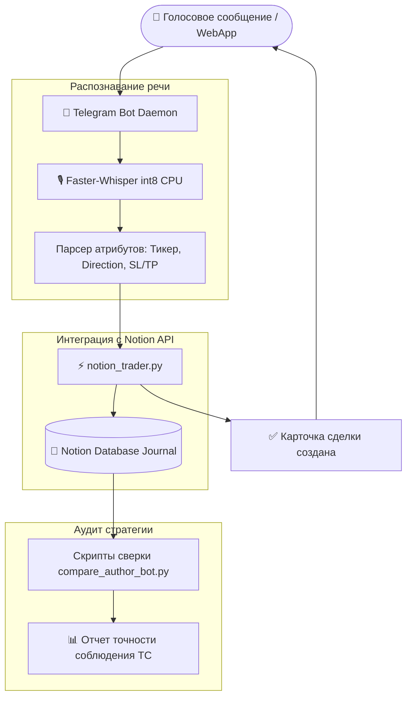

<div align="center">

# ⚡ Trading Journal & Notion Voice Assistant Bot

**Telegram-бот и Mini App для автоматизированного ведения торгового журнала в Notion с поддержкой голосового ввода через Faster-Whisper, расчета Risk-to-Reward (R:R) и аудита сигналов.**

[](https://www.python.org/)
[](https://core.telegram.org/bots)
[](https://developers.notion.com/)
[](https://github.com/SYSTRAN/faster-whisper)
[](LICENSE)

[🇷🇺 Читать на русском](README.md) • [🇬🇧 Read in English](README.en.md)

---

</div>

## 📑 Содержание

1. [Проблема трейдера и решение](#1-проблема-трейдера-и-решение)
   * [1.1. Рутина заполнения журнала](#11-рутина-заполнения-журнала)
   * [1.2. Концепция голосового ассистента](#12-концепция-голосового-ассистента)
2. [Ключевые возможности](#2-ключевые-возможности)
   * [2.1. Голосовой ввод сделки (Faster-Whisper on-device)](#21-голосовой-ввод-сделки-faster-whisper-on-device)
   * [2.2. Прямая синхронизация с базой данных Notion (notion_trader.py)](#22-прямая-синхронизация-с-базой-данных-notion-notion_traderpy)
   * [2.3. Telegram WebApp интерактивная форма](#23-telegram-webapp-интерактивная-форма)
   * [2.4. Верификация сигналов против бэктестов (Silver Bullet)](#24-верификация-сигналов-против-бэктестов-silver-bullet)
3. [Архитектура и потоки данных](#3-архитектура-и-потоки-данных)
   * [3.1. Схема движения торговых данных](#31-схема-движения-торговых-данных)
   * [3.2. Структура репозитория](#32-структура-репозитория)
4. [Стек технологий](#4-стек-технологий)
5. [Установка и запуск](#5-установка-и-запуск)
6. [Автор и контакты](#6-автор-и-контакты)

---

## 1. Проблема трейдера и решение

### 1.1. Рутина заполнения журнала
Качественный торговый журнал — основа прибыльного трейдинга. Однако ручной ввод цен входа, стоп-лосса, тейк-профита и прикрепление графиков занимает от 5 до 10 минут на каждую сделку. В периоды высокой рыночной активности (London/NY Open) трейдеры откладывают запись и упускают критически важные данные о типе сетапа и эмоциональном состоянии.

### 1.2. Концепция голосового ассистента
**Trading Notion Assistant** сокращает время логирования сделки до **5 секунд**: трейдер нажимает кнопку записи голосового сообщения и надиктовывает сделку. Локальная нейросеть Whisper транскрибирует аудио, регулярные выражения и парсер извлекают атрибуты сделки, а модуль `notion_trader.py` автоматически создает карточку в Notion со всеми заполненными свойствами.

---

## 2. Ключевые возможности

### 2.1. Голосовой ввод сделки (Faster-Whisper on-device)
* Локальный запуск модели `faster-whisper small` на CPU с квантованием `int8` (без задержек и без платных API);
* Распознавание терминов трейдинга: *«Лонг по евро 1.0850, стоп 1.0830, тейк 1.0910, риск 1%, сессия Лондон»*.

### 2.2. Прямая синхронизация с базой данных Notion (`notion_trader.py`)
* Автоматическое создание записи в Notion Database со свойствами:
  * Дата и время открытия / закрытия;
  * Валютная пара / тикер инструмента;
  * Направление (Long / Short);
  * Вход, Stop Loss, Take Profit, итоговый результат (Win / Loss / Break-Even);
  * Расчет коэффициента Risk-to-Reward (R:R).

### 2.3. Telegram WebApp интерактивная форма
* Встроенная в Telegram WebApp страница для визуального ввода и быстрого редактирования параметров ордера перед отправкой.

### 2.4. Верификация сигналов против бэктестов (Silver Bullet)
* Скрипты `compare_author_vs_bot_sb.py` сопоставляют зафиксированные сделки трейдера с алгоритмическими сигналами стратегии Silver Bullet.

---

## 3. Архитектура и потоки данных

### 3.1. Схема движения торговых данных



### 3.2. Структура репозитория

```text
08-trading-notion-assistant/
├── telegram_notion_bot.py        # Основной процесс бота (Telegram + WebApp + Whisper)
├── notion_trader.py              # Высокоуровневый клиент Notion Database API
├── compare_author_bot.py         # Скрипт валидации реальных трейдов
├── compare_author_vs_bot_sb.py   # Сравнение сделок со стратегией Silver Bullet
├── requirements.txt              # Зависимости Python
├── .env.example                  # Шаблон токенов Telegram и Notion
├── .gitignore                    # Исключения версионного контроля
├── README.md                     # Документация на русском
└── README.en.md                  # English documentation
```

---

## 4. Стек технологий

* `Python 3.10+`
* `python-telegram-bot 20+` & `Telegram WebApp API`
* `Notion REST API`
* `Faster-Whisper` (Speech-to-Text inference)
* `HTTPX & Requests`

---

## 5. Установка и запуск

```bash
git clone https://github.com/Andrew123485/trading-notion-assistant.git
cd trading-notion-assistant

python -m venv venv
.\venv\Scripts\activate
pip install -r requirements.txt

# Настройка токенов
cp .env.example .env
# Заполните TELEGRAM_BOT_TOKEN и NOTION_TOKEN

# Запуск бота
python telegram_notion_bot.py
```

---

## 6. Автор и контакты

* **Автор:** Владимиров Андрей Георгиевич
* **Специализация:** Бизнес-аналитик / Финтех-разработчик / Трейдер
* **Telegram:** [@amorfatimementomoria](https://t.me/amorfatimementomoria)
* **GitHub:** [github.com/Andrew123485](https://github.com/Andrew123485)
